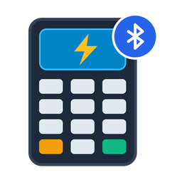
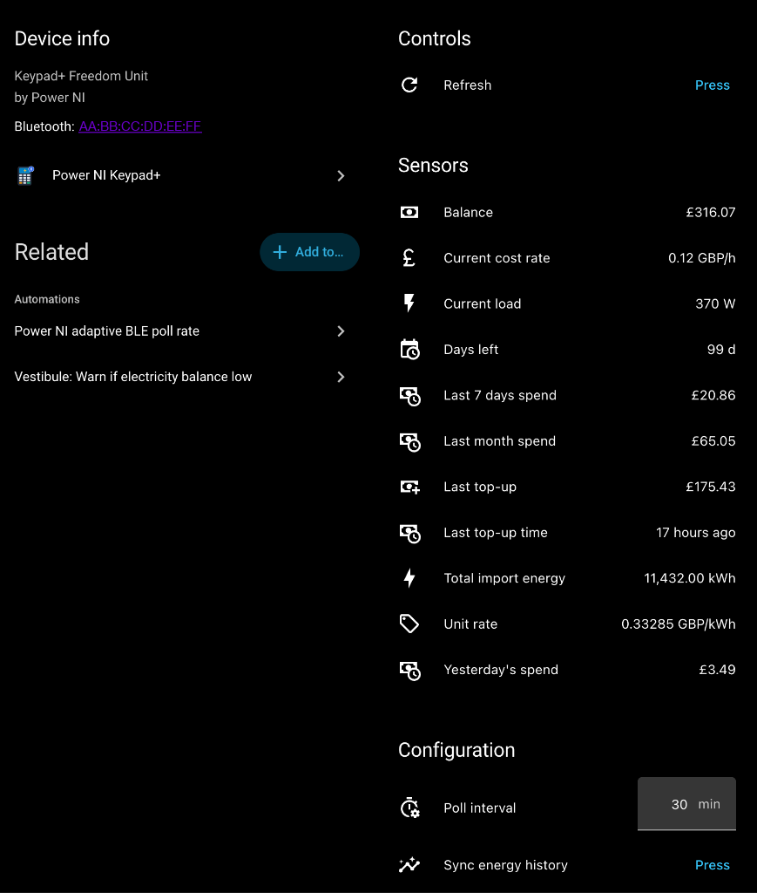

<div align="center">
  
  <h1>Power NI Keypad+ BLE for Home Assistant</h1>
  <p>Local, read-only Home Assistant integration for Power NI <strong>Keypad+ Freedom Units</strong> over Bluetooth Low Energy.</p>

  <p>
    <a href="https://github.com/rorygallagher2024/ha-powerni-ble/releases"></a>
    <a href="https://github.com/hacs/integration"></a>
    <a href="https://github.com/rorygallagher2024/ha-powerni-ble/actions/workflows/ci.yml"></a>
    <a href="https://github.com/rorygallagher2024/ha-powerni-ble/actions/workflows/validate.yml"></a>
    <a href="LICENSE"></a>
  </p>

  <p>
    <a href="#exposed-entities">Entities</a> ·
    <a href="#compatibility">Compatibility</a> ·
    <a href="#prerequisites-one-time-6-digit-pin-pairing">Pairing</a> ·
    <a href="#installation">Installation</a> ·
    <a href="#setup--configuration">Configuration</a> ·
    <a href="#energy-dashboard">Energy Dashboard</a> ·
    <a href="#troubleshooting">Troubleshooting</a> ·
    <a href="#future-roadmap">Roadmap</a>
  </p>
</div>

> [!NOTE]
> **Unofficial / Independent Project:** This integration is not affiliated with, endorsed by, or supported by Power NI, Energia Group, or Eckoh. It communicates **locally and read-only** over Bluetooth Low Energy (BLE) with your own Freedom Unit via a local Linux Bluetooth adapter or an ESPHome Bluetooth Proxy — it never contacts Power NI cloud servers and does not support top-ups or keypad modifications.

<p align="center">
  
  <br />
  <em>Home Assistant device page showing live telemetry, Refresh control, and configurable Poll interval.</em>
</p>

## Exposed Entities

| Entity | Category | Description | Unit | Device / State Class |
| --- | --- | --- | --- | --- |
| **Balance** | Sensor | Remaining Keypad+ credit balance (hourly Long-Term Statistics) | `GBP` | `monetary` / `total` |
| **Days left** | Sensor | Estimated days remaining (`status` attribute e.g. `ABOUT 51`) | `d` | `measurement` |
| **Current load** | Sensor | Instantaneous power draw | `kW` | `power` / `measurement` |
| **Current cost rate** | Sensor | Current hourly cost at active load | `GBP/h` | `measurement` |
| **Total import energy** | Sensor | Cumulative import meter register (Energy Dashboard ready) | `kWh` | `energy` / `total_increasing` |
| **Yesterday's spend** | Sensor | Previous day electricity spend (hourly Long-Term Statistics) | `GBP` | `monetary` / `total` |
| **Last 7 days spend** | Sensor | Rolling 7-day spend (hourly Long-Term Statistics) | `GBP` | `monetary` / `total` |
| **Last month spend** | Sensor | Previous month spend (hourly Long-Term Statistics) | `GBP` | `monetary` / `total` |
| **Last top-up** | Sensor | Estimated last top-up amount (`balance_before` / `balance_after` attributes) | `GBP` | `monetary` |
| **Last top-up time** | Sensor | Timestamp when the last top-up was detected | — | `timestamp` |
| **Last successful read** | Diagnostic | Timestamp of the most recent successful BLE poll | — | `timestamp` |
| **Poll status** | Diagnostic | Live BLE poll state (`idle`, `connecting`, `reading`, `retrying`, `error`) | — | `enum` |
| **Updating** | Diagnostic | `on` while connecting, reading, or retrying a BLE poll | — | `binary_sensor` (`running`) |
| **Refresh** | Control | Button triggering an immediate full BLE read across all sections | — | `button` |
| **Poll interval** | Configuration | Adjustable polling interval synced with **Configure** (`1`–`1440` min) | `min` | `number` (`duration`) |

## How Polling Works

The Freedom Unit only allows one Bluetooth connection at a time. To keep BLE sessions short and resilient:

### Tiered Read Schedule

| Readings | Read frequency | Notes |
| --- | --- | --- |
| **Balance** & **Days left** | Every poll | Always read first |
| **Current load** & **Current cost rate** | Every poll | Live demand and hourly rate |
| **Total import energy** | Once per hour | Also read on startup and **Refresh** |
| **Yesterday / Last 7 days / Last month spend** | Every 6 hours & after midnight | Also read on startup and **Refresh** |

### Live Feedback & Resilience

- **Live refresh feedback:** Pressing **Refresh** immediately transitions **Poll status** (`Connecting` → `Reading` → `Idle`) and flips **Updating** (`on` → `off`). Sections publish progressively during the session, so **Balance**, **Days left**, and **Current load** appear in ~6–10 seconds without waiting for spend history to finish.
- **Disconnect detection & in-poll retry:** If a BLE link drops mid-session, the client aborts waiting immediately without clearing a healthy GATT cache, waits 3 seconds for the meter radio to return to idle, and retries once within the same poll before falling back to shortened `1 / 2 / 5` minute retries.
- **Age-based availability:** Every meter reading sensor carries a `last_read` ISO timestamp attribute showing when that field was actually returned by the meter, and stays available across brief BLE interruptions until older than `max(24 hours, 3 × poll_interval)`.

## Compatibility

### Freedom Unit Hardware

| Unit Serial / Advertised Name | Status | BLE Discovery | Meter BT Reset Code | Notes |
| --- | --- | --- | --- | --- |
| `B#######` (e.g. `B21xxxxx`) | Verified working | ISSC service UUID (`49535343-fe7d-4ae5-8fa9-9fafd205e455`) | `*159268#` | Tested live on real hardware |
| `PNI#####` (e.g. `PNI12345`) | Supported (untested) | `PNI[0-9]{5}` name + ISSC service UUID | `*0#` | Community reports welcome via Issues |
| Other `AAA#####` Freedom Units | Supported (untested) | ISSC service UUID (`49535343-fe7d-4ae5-8fa9-9fafd205e455`) | `*0#` or `*159268#` | Matched by config flow `^[A-Z]{3}\d{5}$` |

### Bluetooth Transports

| Transport | Status | One-Time Bonding Method | Notes |
| --- | --- | --- | --- |
| Local Linux Bluetooth (`bluetoothctl` / BlueZ) | Supported | Pair directly on HA host with `DisplayOnly` agent | Bond persists in host BlueZ storage |
| ESPHome Bluetooth Proxy (`esp-idf`) | Verified working | Temporary OTA flash with [examples/esphome-pair-helper.yaml](examples/esphome-pair-helper.yaml), then restore stock firmware | Bond persists in ESP32 NVS flash across OTA updates; pin the bonded proxy in **Configure** |

## Prerequisites: One-Time 6-Digit PIN Pairing

Power NI Freedom Units require an authenticated BLE bond (`LE Legacy + MITM 6-digit PIN`) before accepting GATT commands. Pair the unit **once** with the Bluetooth adapter or ESP32 proxy that Home Assistant will connect through.

### Option A: Local Linux Bluetooth (`bluetoothctl` on Home Assistant host)

If your Freedom Unit is within range of your Home Assistant server's built-in Bluetooth adapter:

1. Run `bluetoothctl` on the Home Assistant host:
   ```text
   power on
   agent off
   agent DisplayOnly
   default-agent
   scan on
   ```
2. Note your Freedom Unit's MAC address (`AA:BB:CC:DD:EE:FF`, device name like `B1234567`), then run:
   ```text
   scan off
   pair AA:BB:CC:DD:EE:FF
   ```
3. When `bluetoothctl` prints a 6-digit passkey, type that 6-digit PIN followed by `#` on your physical Freedom Unit keypad.
4. Once `Pairing successful` appears, run `trust AA:BB:CC:DD:EE:FF` and `disconnect AA:BB:CC:DD:EE:FF`.

### Option B: ESPHome Bluetooth Proxy (e.g., ESP32 / Everything Presence Lite)

Stock ESPHome `bluetooth_proxy` uses `io_capability: none` and cannot display a 6-digit PIN. However, ESP-IDF stores BLE bonds persistently in NVS flash (`CONFIG_BT_BLE_SMP_BOND_NVS_FLASH=y`), which survives OTA firmware updates:

1. Keep your stock ESPHome proxy firmware ready to re-flash afterward.
2. Temporarily OTA-flash the target ESP32 using [examples/esphome-pair-helper.yaml](examples/esphome-pair-helper.yaml) (updated with your Freedom Unit's MAC address, API key, and your chosen 6-digit PIN).
3. Watch the ESPHome logs until `=== ENTER PASSKEY ON FREEDOM UNIT: 123456# ===` appears, then type that 6-digit PIN followed by `#` on your Freedom Unit keypad.
4. Flash your normal ESPHome Bluetooth Proxy firmware back onto the ESP32 — the BLE bond remains saved in NVS flash.
5. In Home Assistant, open **Configure** on **Power NI Keypad+ BLE** and pin **Bluetooth proxy / adapter** to that bonded proxy.

> [!TIP]
> If your Freedom Unit ignores pairing or stops advertising, reset its internal Bluetooth radio from the keypad by entering **`*159268#`** (`B#######` units) or **`*0#`** (`PNI#####` units).

## Installation

### HACS (Custom Repository)

1. Open **HACS → Integrations → Menu (`⋮`) → Custom repositories**.
2. Add `https://github.com/rorygallagher2024/ha-powerni-ble` with category **Integration**.
3. Install **Power NI Keypad+ BLE** and restart Home Assistant.

### Manual Installation

1. Copy `custom_components/powerni_ble` into your Home Assistant `config/custom_components/` directory.
2. Restart Home Assistant.

## Setup & Configuration

1. Open **Settings → Devices & services**:
   - Auto-discovered meters appear under **Discovered** — click **Add** to confirm.
   - Or click **+ Add integration**, search for **Power NI Keypad+ BLE**, and pick your meter (or choose **Enter MAC address manually**).
2. Click **Configure** on the integration entry at any time to adjust:
   - **Poll interval (minutes):** `1` to `1440` minutes (default `15`).
   - **Bluetooth proxy / adapter:** Leave **Automatic** if only one adapter sees the meter, or pin to the bonded proxy when multiple proxies are in range.

<p align="center">
  
  <br />
  <em>Integration options dialog for adjusting the poll interval and pinning the bonded Bluetooth proxy.</em>
</p>

## Dynamic & Adaptive Polling

Alongside **Configure**, the **Poll interval** `number` entity (`number.<meter>_poll_interval`, `EntityCategory.CONFIG`) can be changed directly on dashboards or in automations:

- Changes stay synced between **Configure** and **Poll interval**, persist across restarts, and reschedule polling immediately without reloading entities.
- Trigger a full on-demand read across all sections at any time using **Refresh** (or `homeassistant.update_entity`).

<details>
<summary>Example automation: poll every 2 minutes while home during the day, 30 minutes overnight</summary>

```yaml
alias: Power NI adaptive BLE poll rate
mode: single
triggers:
  - trigger: homeassistant
    event: start
  - trigger: state
    entity_id: group.household
  - trigger: time
    at:
      - "07:00:00"
      - "23:00:00"
actions:
  - action: number.set_value
    target:
      entity_id: number.b1234567_poll_interval
    data:
      value: >
        
        
        {{ 2 if (daytime and someone_home) else 30 }}
```

</details>

## Top-Up Detection

When a freshly read **Balance** rises by at least **`£1.00`** compared to the previous fresh reading (persisted across Home Assistant restarts):

- Updates **Last top-up** (with `balance_before` and `balance_after` attributes) and **Last top-up time**.
- Fires a `powerni_ble_top_up` event carrying `device_id`, `address`, `name`, `amount`, `balance_before`, and `balance_after`.

Because the Freedom Unit exposes only net credit balance, `amount` is an estimate slightly reduced by any electricity consumed between the two polls.

<details>
<summary>Example automation: send a phone notification when a top-up is detected</summary>

```yaml
alias: Power NI top-up notification
mode: single
triggers:
  - trigger: event
    event_type: powerni_ble_top_up
actions:
  - action: notify.notify
    data:
      title: Electricity top-up detected
      message: >
        Added ~£{{ '%.2f' | format(trigger.event.data.amount) }}.
        New balance: £{{ '%.2f' | format(trigger.event.data.balance_after) }}.
```

</details>

## Energy Dashboard

**Total import energy** (`kWh`, `device_class: energy`, `state_class: total_increasing`) works directly with Home Assistant's built-in **Energy** dashboard:

1. Open **Settings → Dashboards → Energy**.
2. Choose the section matching your setup:
   - **Electricity grid → Add consumption:** Select **Total import energy** to track grid import alongside solar or battery systems, and optionally add a static or entity tariff price (`GBP/kWh`).
   - **Home consumption:** Select **Total import energy** under **Home energy** (and optionally **Current load** under **Home power**) if monitoring whole-home electricity directly from the Freedom Unit, then click **Save**.
3. Wait 1–2 hours for Home Assistant's hourly Long-Term Statistics bars to appear.

<p align="center">
  
  <br />
  <em>Adding Total import energy in Home Assistant's Energy Dashboard settings.</em>
</p>

> [!NOTE]
> The Freedom Unit reports `Total import energy` in whole `kWh` integers (`0` decimal precision on the meter itself). Hourly Energy Dashboard bars therefore increment in `1 kWh` steps.

## Troubleshooting

### Weak BLE signal (`RSSI`) or intermittent timeouts

- Check the RSSI shown next to your adapter or proxy in **Configure**. Signal stronger than **`-80 dBm`** is recommended; weaker than `-88 dBm` can drop while negotiating GATT encryption.
- Move an ESPHome Bluetooth Proxy closer to the Freedom Unit (same room or hallway) and use the `esp-idf` framework.

### Freedom Unit stops responding to pairing or scans

- Freedom Units occasionally stop accepting new bonds or wedge their BLE radio after failed pairing attempts.
- Toggle Bluetooth off and back on from the physical keypad:
  - **`B#######` units:** `*159268#`
  - **`PNI#####` units:** `*0#`

### Phone app contention

- The Microchip/ISSC BLE module supports only **one active BLE connection at a time**.
- While the official Power NI Keypad+ phone app is open and connected, Home Assistant polls cannot connect until the app is closed.
- Always close the phone app before running the one-time PIN pairing. During normal polling, Home Assistant connects briefly and disconnects cleanly afterward.

### `Insufficient authorization (8)` or `Pairing failed due to error: 102`

- **`Insufficient authorization (8)`:** The adapter or proxy Home Assistant selected does not hold a valid 6-digit PIN bond. Complete the [One-Time 6-Digit PIN Pairing](#prerequisites-one-time-6-digit-pin-pairing) steps on that proxy and pin **Bluetooth proxy / adapter** in **Configure** so Home Assistant does not roam onto an unbonded proxy.
- **`error: 102` (`ESP_AUTH_SMP_CONN_TOUT`):** During ESPHome pairing, the 6-digit PIN was not entered as `NNNNNN#` on the Freedom Unit keypad before the ~30-second SMP timeout. Enter `*159268#` (or `*0#`) on the keypad and retry while watching logs.

### Brand icon shows "icon not available"

- Local integration brand icons (`custom_components/powerni_ble/brand/`) are served by Home Assistant 2026.x+. Restart Home Assistant after installing and hard-refresh your browser (`Cmd+Shift+R` / `Ctrl+Shift+R`).

## Future Roadmap

- **Broadcast-aware polling:** Listen to per-address BLE advertisements so polling pauses cleanly while the mobile app holds the meter connection and resumes immediately when the meter starts advertising again.
- **Actionable pairing diagnostics & HA Repairs:** Raise clear Repair issues when an unbonded proxy hits `Insufficient authorization (8)`, identifying the proxy that needs bonding.
- **Automatic bonded-proxy detection & stickiness:** Remember which proxy succeeds and prefer it automatically without manual pinning.
- **Zero-CLI ESPHome pairing helper:** Expose the passkey and pairing status via ESPHome `text_sensor` / `button` entities directly in Home Assistant.
- **14-day half-hourly survey backfill (`0xA0`):** Import the meter's stored 30-minute `kWh` history into Home Assistant Long-Term Statistics.
- **12-month historical spend (`JAN`–`DEC`) & meter serial (`0x80`):** Parse the remaining monthly spend frames from `0xC2 0x32` and binary serial/diagnostics frames from `0x80`.
- **Notification Blueprint:** Pre-built Blueprint for low-credit, low-days-remaining, and top-up notifications.
