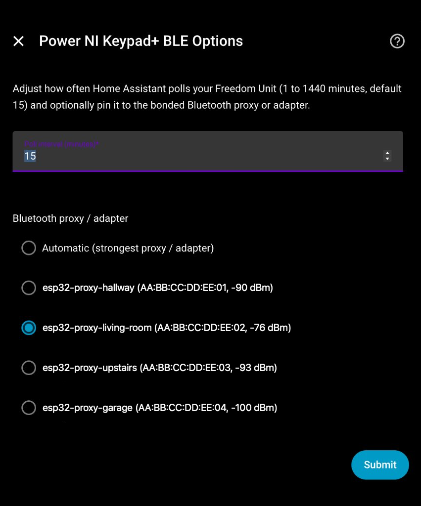
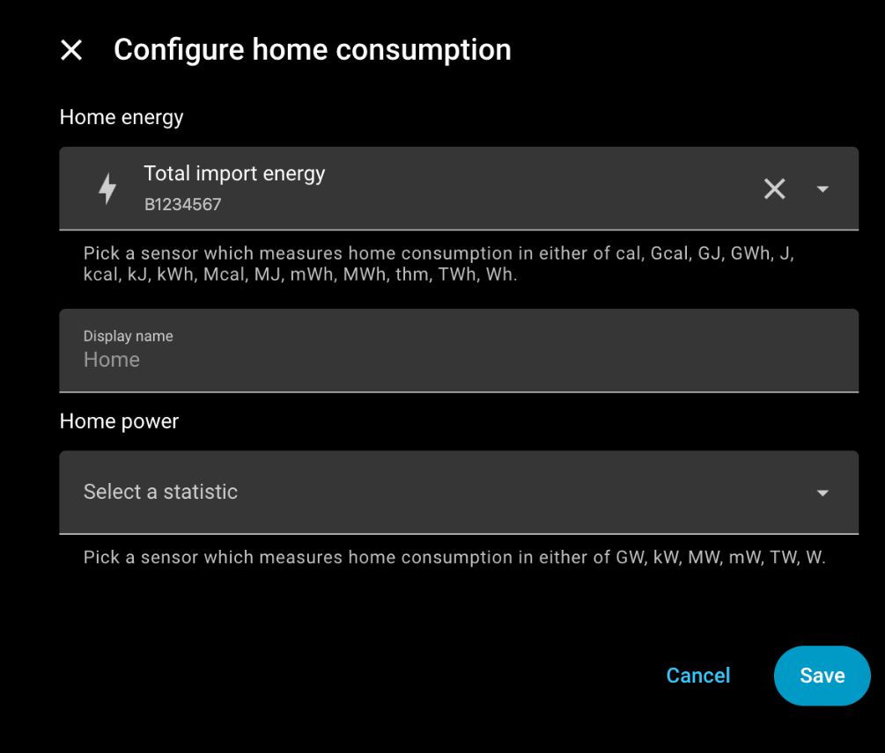

# Power NI Keypad+ BLE for Home Assistant

> **Unofficial / Independent Project:** This integration is not affiliated with, endorsed by, or supported by Power NI, Energia Group, or Eckoh. It communicates **locally and read-only** over Bluetooth Low Energy (BLE) with your own Freedom Unit — it never contacts Power NI cloud servers and does not support top-ups or keypad modifications.

Read live electricity telemetry from Power NI **Keypad+ Freedom Units** (`B#######` / `PNI#####` serials) into Home Assistant over Bluetooth Low Energy via a local Linux Bluetooth adapter or an ESPHome Bluetooth Proxy.


## Exposed Entities

| Entity | Category | Description | Unit | Device / State Class |
| --- | --- | --- | --- | --- |
| **Balance** | Sensor | Remaining Keypad+ credit balance (hourly Long-Term Statistics) | `GBP` | `monetary` / `total` |
| **Days left** | Sensor | Estimated days remaining (`status` attribute e.g. `ABOUT 51`) | `d` | `measurement` |
| **Current load** | Sensor | Instantaneous power draw | `kW` | `power` / `measurement` |
| **Current cost rate** | Sensor | Current hourly cost at active load | `GBP/h` | `measurement` |
| **Total import energy** | Sensor | Cumulative import meter register (Energy Dashboard ready) | `kWh` | `energy` / `total_increasing` |
| **Yesterday's spend** | Sensor | Previous day electricity spend | `GBP` | `monetary` / `total` |
| **Last 7 days spend** | Sensor | Rolling 7-day spend | `GBP` | `monetary` / `total` |
| **Last month spend** | Sensor | Previous month spend | `GBP` | `monetary` / `total` |
| **Last top-up** | Sensor | Estimated last top-up amount (`balance_before` / `balance_after` attributes) | `GBP` | `monetary` |
| **Last top-up time** | Sensor | When the last top-up was detected | — | `timestamp` |
| **Last successful read** | Diagnostic | Timestamp of the most recent successful BLE poll | — | `timestamp` |
| **Refresh** | Control | Button triggering an immediate on-demand BLE read | — | `button` |
| **Poll interval** | Configuration | Adjustable polling interval synced with **Configure** (`1`–`1440` min) | `min` | `number` (`duration`) |

Every meter reading sensor carries a `last_read` ISO timestamp attribute showing when that specific field was actually returned by the meter, and remains available across temporary BLE drops until its value is older than `max(24 hours, 3 × poll_interval)`.

## Compatibility

### Freedom Unit Hardware

| Unit Serial / Advertised Name | Status | BLE Discovery | Meter BT Reset Code | Notes |
| --- | --- | --- | --- | --- |
| `B#######` (e.g. `B21xxxxx`) | Verified working | ISSC service UUID (`49535343-fe7d-4ae5-8fa9-9fafd205e455`) | `*159268#` | Tested live on real hardware |
| `PNI#####` (e.g. `PNI12345`) | Supported (untested) | `PNI[0-9]{5}` name + ISSC service UUID | `*0#` | Community reports welcome via Issues |
| Other `AAA#####` prefixed Freedom Units | Supported (untested) | ISSC service UUID (`49535343-fe7d-4ae5-8fa9-9fafd205e455`) | `*0#` or `*159268#` | Matched by config flow `^[A-Z]{3}\d{5}$` |

### Bluetooth Transports

| Transport | Status | One-Time Bonding Method | Notes |
| --- | --- | --- | --- |
| Local Linux Bluetooth (`bluetoothctl` / BlueZ) | Supported | Pair directly on HA host with `DisplayOnly` agent | Bond persists in host BlueZ storage |
| ESPHome Bluetooth Proxy (`esp-idf`) | Verified working | Temporary OTA flash with [examples/esphome-pair-helper.yaml](examples/esphome-pair-helper.yaml), then restore stock firmware | Bond persists in ESP32 NVS flash across OTA updates; pin the bonded proxy in **Configure** |

## Prerequisites: One-Time 6-Digit PIN Pairing

Power NI Freedom Units require an authenticated BLE bond (`LE Legacy + MITM 6-digit PIN`) before accepting GATT commands. You must pair the unit **once** with the Bluetooth adapter or ESP32 proxy that Home Assistant will connect through.

### Option A: Local Linux Bluetooth (`bluetoothctl` on Home Assistant host)

If your Freedom Unit is within range of your Home Assistant server's built-in Bluetooth adapter:

1. Run `bluetoothctl` on the Home Assistant host:
   ```text
   power on
   agent off
   agent DisplayOnly
   default-agent
   scan on
   ```
2. Note your Freedom Unit's MAC address (`AA:BB:CC:DD:EE:FF`, device name like `B1234567`), then run:
   ```text
   scan off
   pair AA:BB:CC:DD:EE:FF
   ```
3. When `bluetoothctl` prints a 6-digit passkey, type that 6-digit PIN followed by `#` on your physical Freedom Unit keypad.
4. Once `Pairing successful` appears, run `trust AA:BB:CC:DD:EE:FF` and `disconnect AA:BB:CC:DD:EE:FF`.

### Option B: ESPHome Bluetooth Proxy (e.g., ESP32 / Everything Presence Lite)

Stock ESPHome `bluetooth_proxy` uses `io_capability: none` and cannot display a 6-digit PIN. However, ESP-IDF stores BLE bonds persistently in NVS flash (`CONFIG_BT_BLE_SMP_BOND_NVS_FLASH=y`), which survives OTA firmware updates:

1. Keep your stock ESPHome proxy firmware ready to re-flash afterward.
2. Temporarily OTA-flash the target ESP32 using [examples/esphome-pair-helper.yaml](examples/esphome-pair-helper.yaml) (updated with your Freedom Unit's MAC address and your chosen 6-digit PIN).
3. Watch the ESPHome logs until `=== ENTER PASSKEY ON FREEDOM UNIT: 123456# ===` appears, then type that 6-digit PIN followed by `#` on your Freedom Unit keypad.
4. Flash your normal ESPHome Bluetooth Proxy firmware back onto the ESP32 — the BLE bond remains saved in NVS flash.
5. In Home Assistant, open **Configure** on the **Power NI Keypad+ BLE** integration and pin **Bluetooth proxy / adapter** to that specific bonded proxy.

## Installation

### HACS (Custom Repository)

1. In HACS -> **Integrations** -> menu (`⋮`) -> **Custom repositories**, add `https://github.com/rorygallagher2024/ha-powerni-ble` with category **Integration**.
2. Install **Power NI Keypad+ BLE** and restart Home Assistant.

### Manual Installation

1. Copy `custom_components/powerni_ble` into your Home Assistant `config/custom_components/` directory.
2. Restart Home Assistant.

## Setup & Configuration

1. Go to **Settings -> Devices & services**:
   - Auto-discovered meters appear under **Discovered**; click **Add** to confirm.
   - Or click **+ Add integration**, search for **Power NI Keypad+ BLE**, and pick your meter from the list (or choose **Enter MAC address manually**).
2. Click **Configure** on the integration entry at any time to change:
   - **Poll interval (minutes):** `1` to `1440` minutes (default `15`).
   - **Bluetooth proxy / adapter:** Leave **Automatic** if only one adapter sees the meter, or pin it to the specific bonded ESPHome proxy when multiple proxies are in range.
3. Each poll connects over BLE, reads telemetry, leaves transparent mode cleanly, and disconnects so your mobile app can still connect when needed.



## Dynamic & Adaptive Polling

Alongside the **Configure** dialog, the integration exposes a **Poll interval** `number` entity (`number.<meter>_poll_interval`, `EntityCategory.CONFIG`):

- Changes made on a dashboard, via automations (`number.set_value`), or in **Configure** stay synced with each other and persist across restarts.
- Adjusting the interval reschedules the coordinator's timer in-place without reloading entities or forcing an immediate BLE read.
- You can also trigger an immediate read at any time with the **Refresh** button entity (or `homeassistant.update_entity`).

## Top-Up Detection & Resilience

- **Top-up detection (`powerni_ble_top_up`):** When a freshly read **Balance** rises by at least `£1.00` compared to the previous fresh reading (persisted across Home Assistant restarts), the integration updates **Last top-up** and **Last top-up time** and fires a `powerni_ble_top_up` event with `device_id`, `address`, `name`, `amount`, `balance_before`, and `balance_after`. Because the meter only exposes net balance, `amount` is an estimate slightly reduced by any electricity used between the two polls.
- **Disconnect recovery & staleness:** If the BLE connection drops mid-poll, the client aborts waiting immediately (without wiping the GATT service cache), waits briefly for the meter radio to return to idle, and retries once inside the same poll before falling back to shortened `1 / 2 / 5` minute retries. Existing sensor readings remain available with their `last_read` timestamp until they exceed `max(24 hours, 3 × poll_interval)`.

Example automation that polls every **2 minutes** during the day while someone is home and slows down to every **30 minutes** overnight:

```yaml
alias: Power NI adaptive BLE poll rate
mode: single
triggers:
  - trigger: homeassistant
    event: start
  - trigger: state
    entity_id: group.household
  - trigger: time
    at:
      - "07:00:00"
      - "23:00:00"
actions:
  - action: number.set_value
    target:
      entity_id: number.b1234567_poll_interval
    data:
      value: >
        
        
        {{ 2 if (daytime and someone_home) else 30 }}
```

## Energy Dashboard Guide

**Total import energy** (`kWh`, `device_class: energy`, `state_class: total_increasing`) works directly with Home Assistant's built-in **Energy** dashboard:

1. Open **Settings -> Dashboards -> Energy**.
2. Choose the section that matches your setup:
   - **Electricity grid -> Add consumption:** Choose `Total import energy` as your **Consumed energy** sensor to track grid imports alongside solar/battery systems, and optionally enable static or entity-based tariff cost tracking (`GBP/kWh`).
   - **Home consumption:** If you want to monitor whole-home consumption directly from the Freedom Unit, click **Home consumption** -> select `Total import energy` under **Home energy** (and optionally `Current load` under **Home power**), then click **Save**.
3. Wait up to 1–2 hours for Home Assistant's hourly Long-Term Statistics bars to populate.



> **Note:** The Freedom Unit reports `Total import energy` in whole `kWh` integers (`0` decimal precision on the meter itself). Energy Dashboard hourly bars therefore step in `1 kWh` increments rather than `0.001 kWh`.

## Troubleshooting

### Weak BLE signal (`RSSI`) or intermittent timeouts

- Check the RSSI shown next to your adapter or proxy in **Configure**. Readings stronger than **`-80 dBm`** are recommended; weaker than `-88 dBm` may time out while negotiating GATT encryption.
- Move an ESPHome Bluetooth Proxy closer to the Freedom Unit (or into the same room / hallway), and ensure the ESP32 uses `esp-idf` framework (standard for modern ESPHome Bluetooth proxies).

### Freedom Unit stops responding to pairing or scans

- Power NI Freedom Units occasionally stop accepting new bonds or wedge their BLE radio after failed pairing attempts.
- Toggle Bluetooth off and back on from the physical keypad:
  - **`B#######` units:** press **`*159268#`**
  - **`PNI#####` units:** press **`*0#`**

### Phone app contention

- The Microchip/ISSC BLE module in the Freedom Unit supports only **one active BLE connection at a time**.
- While the official Power NI Keypad+ phone app is open and connected, Home Assistant polls will fail to connect until you close the app.
- Close the app before performing the one-time PIN pairing. During normal operation, Home Assistant connects for only ~3–5 seconds per poll and disconnects cleanly afterward.

### `Insufficient authorization (8)` or `Pairing failed due to error: 102`

- **`Insufficient authorization (8)`** means the adapter/proxy Home Assistant chose does not hold a valid 6-digit PIN bond with the Freedom Unit. Complete the [One-Time 6-Digit PIN Pairing](#prerequisites-one-time-6-digit-pin-pairing) steps on that proxy and pin **Bluetooth proxy / adapter** in **Configure** so Home Assistant does not roam onto another unbonded proxy in your home.
- **`error: 102` (`ESP_AUTH_SMP_CONN_TOUT`)** during ESPHome pairing means the 6-digit PIN was not typed as `NNNNNN#` on the Freedom Unit keypad within the ~30-second SMP timeout window. Enter `*159268#` (or `*0#`) on the keypad and retry while watching the ESPHome logs.

### Brand icon shows "icon not available"

- Home Assistant serves integration brand icons from `custom_components/powerni_ble/brand/` starting from HA 2026.x+. After installing or upgrading, restart Home Assistant and hard-refresh your browser (`Cmd+Shift+R` / `Ctrl+Shift+R`) to clear cached asset responses.

## Future Roadmap

Planned enhancements for future releases:

- **Actionable pairing diagnostics & HA Repairs:** Surface clear Repair issues in Home Assistant when an unbonded proxy returns `Insufficient authorization (8)`, pointing directly to the proxy that needs bonding.
- **Automatic bonded-proxy detection & stickiness:** Remember which proxy succeeded and automatically fall back or prefer it without manual pinning.
- **Zero-CLI ESPHome pairing helper:** Expose the one-time PIN and pairing status via ESPHome `text_sensor` / `button` entities directly in Home Assistant so users never need CLI logs.
- **14-day half-hourly survey backfill (`0xA0`):** Import the meter's 14 days of stored 30-minute `kWh` history into Home Assistant Long-Term Statistics for instant historical Energy Dashboard graphs.
- **12-month historical spend (`JAN`–`DEC`) & meter serial (`0x80`):** Parse the remaining monthly spend frames from `0xC2 0x32` and the binary meter serial / diagnostics frames from `0x80`.
- **Notification Blueprint:** Pre-built Blueprint for low-credit (`Balance` < threshold) and low-days-remaining alerts.
