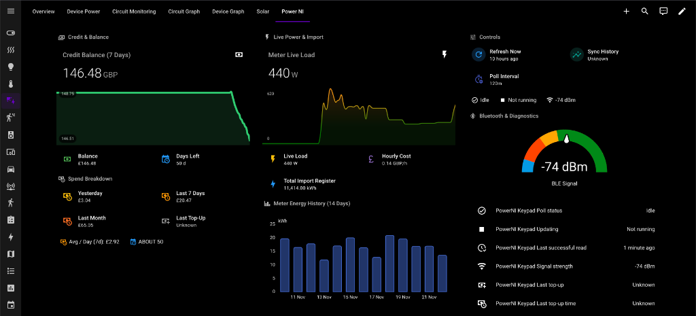

<div align="center">
  
  <h1>Power NI Keypad+ for Home Assistant</h1>
  <p>Home Assistant integration for <strong>Power NI (PowerNI) Keypad+</strong> prepay electricity meters (Freedom Units) in Northern Ireland over Bluetooth.</p>

  <p>
    <a href="https://github.com/rorygallagher2024/ha-powerni-ble/releases"></a>
    <a href="https://www.home-assistant.io/"></a>
    <a href="https://my.home-assistant.io/redirect/hacs_repository/?owner=rorygallagher2024&repository=ha-powerni-ble&category=integration"></a>
    <a href="https://github.com/rorygallagher2024/ha-powerni-ble/actions/workflows/ci.yml"></a>
    <a href="https://github.com/rorygallagher2024/ha-powerni-ble/actions/workflows/validate.yml"></a>
    <a href="LICENSE"></a>
  </p>

  <p>
    <a href="#compatibility">Compatibility</a> ·
    <a href="#prerequisites-one-time-6-digit-pin-pairing">Pairing</a> ·
    <a href="#installation">Installation</a> ·
    <a href="#setup--configuration">Configuration</a> ·
    <a href="#exposed-entities">Entities</a> ·
    <a href="#energy-dashboard">Energy Dashboard</a> ·
    <a href="#automations">Automations</a> ·
    <a href="#troubleshooting">Troubleshooting</a>
  </p>
</div>

> [!NOTE]
> **Unofficial / Independent Project:** This integration is not affiliated with, endorsed by, or supported by Power NI, NIE Networks, Energia Group, or Eckoh. It communicates **locally and read-only** over Bluetooth with your own Freedom Unit (either directly from your Home Assistant server or via a nearby Bluetooth bridge). It never contacts Power NI servers and cannot top up or change your meter.

## Highlights

- **100% local & read-only:** Reads directly from your keypad over Bluetooth. No cloud account or login needed.
- **Credit and usage at a glance:** See your remaining balance, estimated days left, live electricity draw, and daily, weekly, and monthly spend right in Home Assistant.
- **Low-credit & top-up notifications:** Automatically spots top-ups and gives you everything you need for low-balance alerts.
- **Plays nicely with the official phone app:** Automatically pauses while you're using the Power NI app and catches up as soon as you close it.
- **Optional Energy Dashboard history:** Can pull up to 14 days of hourly electricity usage straight from your meter.

<p align="center">
  
  <br />
  <em>Example Home Assistant dashboard showing 7-day credit balance, live load, 14-day meter energy history, and Bluetooth status.</em>
</p>

## Compatibility

- **Home Assistant:** Requires **`2026.10.0`** or newer (tested live on **`2026.11.1`**).

### Supported Keypads

Freedom Units are owned and installed by NIE Networks; the Bluetooth (Keypad+) upgrade is currently offered by Power NI.

| Keypad Serial | Status | Bluetooth Reset Code | Notes |
| --- | --- | --- | --- |
| `B#######` (e.g. `B21xxxxx`) | Verified working | `*159268#` | Tested live on real hardware |
| `PNI#####` (e.g. `PNI12345`) | Supported (untested) | `*0#` | Community reports welcome via Issues |
| Other `AAA#####` Freedom Units | Supported (untested) | `*0#` or `*159268#` | Detected automatically during setup |

### How Home Assistant Connects to Your Meter

Because the keypad uses Bluetooth, Home Assistant needs a Bluetooth receiver within range of it:

| Connection Method | Best For | One-Time Pairing |
| --- | --- | --- |
| **Built-in or USB Bluetooth** on your Home Assistant machine | Home Assistant is close enough to reach your keypad directly | Pair once from the Home Assistant terminal |
| **ESPHome Bluetooth Proxy** *(a small Wi-Fi + Bluetooth bridge — like an ESP32 board or Everything Presence Lite — placed near your keypad)* | Home Assistant is too far away from your keypad | Pair once using our drop-in helper button in Home Assistant |

## Prerequisites: One-Time 6-Digit PIN Pairing

Just like setting up the official Power NI phone app, your keypad requires a **one-time 6-digit PIN pairing** before Home Assistant can read from it. Pick whichever Bluetooth setup you use below:

<details>
<summary><strong>Option A: Built-in or USB Bluetooth on your Home Assistant machine</strong></summary>

If your Home Assistant machine is close enough to reach your keypad directly:

1. Open a terminal (or SSH) on your Home Assistant machine and run `bluetoothctl`, then enter:
   ```text
   power on
   agent off
   agent DisplayOnly
   default-agent
   scan on
   ```
2. Wait for your keypad to appear (e.g. `B1234567`) and note its Bluetooth address (`AA:BB:CC:DD:EE:FF`), then run:
   ```text
   scan off
   pair AA:BB:CC:DD:EE:FF
   ```
3. When a 6-digit PIN appears on screen, type that 6-digit PIN followed by `#` on your physical Freedom Unit keypad.
4. Once `Pairing successful` appears, run `trust AA:BB:CC:DD:EE:FF` and `disconnect AA:BB:CC:DD:EE:FF`.

</details>

<details>
<summary><strong>Option B: ESPHome Bluetooth Proxy (e.g., ESP32 or Everything Presence Lite)</strong></summary>

Standard ESPHome Bluetooth Proxies can't show a 6-digit pairing PIN on their own, so we temporarily add a small pairing helper to your proxy. Once paired, your proxy remembers the keypad permanently — even after you remove the helper and update it normally:

1. In the ESPHome Dashboard, edit your existing Bluetooth Proxy YAML and add these lines (replacing the Bluetooth address with your keypad's address, and picking any 6-digit PIN):
   ```yaml
   substitutions:
     powerni_mac: "AA:BB:CC:DD:EE:FF"
     powerni_pin: "123456"

   packages:
     powerni_pair:
       url: https://github.com/rorygallagher2024/ha-powerni-ble
       ref: main
       files: [examples/esphome-pair-package.yaml]
   ```
2. Click **Install** to update the proxy wirelessly (your existing board settings, Wi-Fi, and sensors stay untouched).
3. In Home Assistant, open that ESPHome device and press **Pair Power NI Meter**.
4. When **Power NI Pairing Status** says `Enter 123456# on keypad`, type that 6-digit PIN followed by `#` on your physical Freedom Unit keypad.
5. Wait ~35 seconds until status says **`Paired! Safe to remove pairing helper`**, then remove the `substitutions:` / `packages:` lines and click **Install** again — the pairing stays saved on the proxy.
6. Leave **Bluetooth proxy / adapter** on **Automatic** in Power NI Keypad+ settings (it automatically remembers your paired proxy), or choose that proxy manually under **Configure**.

*(Setting up a brand-new blank ESP32 with no existing ESPHome config? See the standalone starter config in [examples/esphome-pair-helper.yaml](examples/esphome-pair-helper.yaml).)*

</details>

> [!TIP]
> If your keypad ignores pairing or stops showing up in Bluetooth scans, toggle its Bluetooth off and back on from the physical keypad by entering **`*159268#`** (`B#######` units) or **`*0#`** (`PNI#####` units).

## Installation

Requires **Home Assistant `2026.10.0` or newer**.

### Home Assistant Marketplace / HACS (Recommended)

[](https://my.home-assistant.io/redirect/hacs_repository/?owner=rorygallagher2024&repository=ha-powerni-ble&category=integration)

Or install directly from the UI:

1. Open **Settings → Marketplace** (Home Assistant `2026.11+`), or **HACS → Integrations** on Home Assistant `2026.10`.
2. Search for **`Power NI Keypad+`** (or **`powerni`**).
3. Click **Download** / **Install** and restart Home Assistant.

### Manual Installation

1. Copy `custom_components/powerni_ble` into your Home Assistant `config/custom_components/` directory.
2. Restart Home Assistant.

## Setup & Configuration

1. Open **Settings → Devices & services**:
   - Auto-discovered meters appear under **Discovered** — click **Add** to confirm.
   - Or click **+ Add integration**, search for **Power NI Keypad+**, and pick your meter (or choose **Enter MAC address manually**).
2. Click **Configure** on the integration at any time to adjust:
   - **Poll interval (minutes):** How often Home Assistant checks your meter — `1` to `1440` minutes (default `15`).
   - **Bluetooth proxy / adapter:** Leave on **Automatic** to remember and reuse your paired proxy automatically, or pick a specific proxy if more than one can reach your keypad.
   - **Automatically sync 14-day energy history (every 6 hours):** Turn off if you only want manual **Sync energy history** imports (helpful if you already track whole-home energy with solar inverters or power clamps).

<p align="center">
  
  <br />
  <em>Integration options dialog for adjusting how often the meter is checked and choosing your Bluetooth proxy.</em>
</p>

## Exposed Entities

### Sensors

| Entity | What it shows | Unit |
| --- | --- | --- |
| **Balance** | Remaining Keypad+ credit balance | `GBP` |
| **Days left** | Estimated days of credit remaining (with meter text such as `ABOUT 51`) | `d` |
| **Current load** | Live electricity power draw | `kW` |
| **Current cost rate** | Current hourly cost at your live load | `GBP/h` |
| **Total import energy** | Cumulative meter reading (works with the Energy Dashboard) | `kWh` |
| **Total export energy** | Cumulative exported energy for solar/microgeneration *(disabled by default — enable on the device page)* | `kWh` |
| **Unit rate** | Active electricity unit price (ready for Energy Dashboard pricing) | `GBP/kWh` |
| **Yesterday's spend** | Electricity spent yesterday | `GBP` |
| **Last 7 days spend** | Rolling 7-day electricity spend | `GBP` |
| **Last month spend** | Previous month electricity spend | `GBP` |
| **Last top-up** | Estimated amount of your last top-up (includes balance before and after) | `GBP` |
| **Last top-up time** | When the last top-up was detected | — |

### Controls & Configuration

| Entity | Type | What it does |
| --- | --- | --- |
| **Refresh** | Button | Reads all figures from the keypad immediately |
| **Sync energy history** | Button | Pulls up to 14 days of detailed hourly electricity usage from the meter |
| **Poll interval** | Number (`1`–`1440` min) | Changes how often the meter is read (synced with **Configure**) |

### Diagnostics

| Entity | What it shows | Unit |
| --- | --- | --- |
| **Last successful read** | When Home Assistant last successfully read the keypad | — |
| **Poll status** | Current connection state (`Idle`, `Connecting`, `Reading`, `Retrying`, `Waiting for meter`, `Error`) | — |
| **Signal strength** | Bluetooth signal strength from your adapter or proxy | `dBm` |
| **Updating** | Turns `on` while a Bluetooth read is in progress | — |

<p align="center">
  
  <br />
  <em>Home Assistant device page showing live readings, Unit rate, Refresh, Sync energy history, and adjustable Poll interval.</em>
</p>

## Energy Dashboard

The integration gives you two ways to add your meter to Home Assistant's **Energy** dashboard:

- **`Total import energy`:** Updates live in whole `1 kWh` steps (matching the meter's screen).
- **`Energy history`:** Pulls up to 14 days of detailed hourly usage straight from your meter for smoother hourly graphs, kept completely separate from any existing solar or energy sensors. You can turn off automatic 6-hour syncing in **Configure** if you prefer manual imports only.

1. Open **Settings → Dashboards → Energy**.
2. Choose the section matching your setup:
   - **Electricity grid → Add consumption:** Select **Total import energy** (or **`<meter> Energy history`** for smoother hourly bars) to track grid import alongside solar or battery systems. Under tariff pricing, choose **Use an entity with current price** and pick **`Unit rate`** (`GBP/kWh`) so Home Assistant updates your costs automatically if your rate changes. If you have solar panels and enabled **`Total export energy`**, you can also add it under **Add return** (Return to grid).
   - **Home consumption:** Select **Total import energy** (or **`<meter> Energy history`**) under **Home energy** and optionally **Current load** under **Home power**, then click **Save**.
3. Wait 1–2 hours for hourly bars to appear (historical **Energy history** bars show up right after the first sync).

<p align="center">
  
  <br />
  <em>Adding Total import energy in Home Assistant's Energy Dashboard settings.</em>
</p>

> [!NOTE]
> The **Total import energy** sensor matches the meter screen in whole `1 kWh` steps, so its hourly bars step in whole kilowatt-hours. Pick **`<meter> Energy history`** instead if you want fine-grained hourly bars.

## Automations

### Dynamic & Adaptive Polling

Alongside **Configure**, you can change the **Poll interval** number directly from dashboards or automations — for example, polling more often while you're home during the day and slowing down overnight:

- Changes stay synced with **Configure**, survive Home Assistant restarts, and take effect immediately.
- Press **Refresh** anytime to trigger a full on-demand reading.

<details>
<summary>Example automation: poll every 2 minutes while home during the day, 30 minutes overnight</summary>

```yaml
alias: Power NI adaptive BLE poll rate
mode: single
triggers:
  - trigger: homeassistant
    event: start
  - trigger: numeric_state
    entity_id: zone.home
    above: 0
  - trigger: numeric_state
    entity_id: zone.home
    below: 1
  - trigger: time
    at:
      - "07:00:00"
      - "23:00:00"
actions:
  - action: number.set_value
    target:
      entity_id: number.b1234567_poll_interval
    data:
      value: >
        
        
        {{ 2 if (daytime and someone_home) else 30 }}
```

</details>

### Top-Up Detection

Whenever a fresh reading shows your **Balance** increased by at least **`£1.00`**:

- Updates **Last top-up** (with balance before and after) and **Last top-up time**.
- Fires a `powerni_ble_top_up` event you can use in automations (carrying `amount`, `balance_before`, and `balance_after`).

Because the keypad only reports net credit balance, the detected top-up amount is an estimate slightly reduced by any electricity used between the two readings.

<details>
<summary>Example automation: send a phone notification when a top-up is detected</summary>

```yaml
alias: Power NI top-up notification
mode: single
triggers:
  - trigger: event
    event_type: powerni_ble_top_up
actions:
  - action: notify.notify
    data:
      title: Electricity top-up detected
      message: >
        Added ~£{{ '%.2f' | format(trigger.event.data.amount) }}.
        New balance: £{{ '%.2f' | format(trigger.event.data.balance_after) }}.
```

</details>

<details>
<summary>Example automation: alert when balance or days remaining drops low</summary>

```yaml
alias: Power NI low credit alert
mode: single
triggers:
  - trigger: numeric_state
    entity_id: sensor.b1234567_balance
    below: 10
  - trigger: numeric_state
    entity_id: sensor.b1234567_days_left
    below: 4
actions:
  - action: notify.notify
    data:
      title: Power NI credit running low
      message: >
        Remaining balance: £{{ '%.2f' | format(states('sensor.b1234567_balance') | float(0)) }}
        (~{{ states('sensor.b1234567_days_left') }} days left).
```

</details>

## How Polling Works

The Freedom Unit only allows one Bluetooth connection at a time, so Home Assistant keeps each check short and only reads slower-changing figures when needed:

### Read Schedule

| Readings | How often they're read | Notes |
| --- | --- | --- |
| **Balance** & **Days left** | Every poll | Always read first |
| **Current load** & **Current cost rate** | Every poll | Live demand and hourly cost |
| **Total import energy** | Once per hour | Also read on startup and **Refresh** |
| **Total export energy** | Once per hour (when enabled) | Disabled by default; also read on startup and **Refresh** |
| **Unit rate** | Every 6 hours & after midnight | Also read on startup and **Refresh** |
| **Yesterday / Last 7 days / Last month spend** | Every 6 hours & after midnight | Also read on startup and **Refresh** |
| **14-day hourly energy history** | Every 6 hours (background) | Fills in detailed hourly bars for the Energy Dashboard |

> [!TIP]
> **Only want the figures you care about?** Disabling all sensors in any reading group on the Power NI Keypad+ device page automatically skips those Bluetooth queries on future polls.

### Built-In Resilience

- **Pauses cleanly for the phone app:** While the Power NI app is connected to your meter, Home Assistant notices the meter is busy, pauses quietly in **`Waiting for meter`** status without error logs, and catches up as soon as the app disconnects (after 30 minutes of silence it switches to **`Error`** so prolonged issues are visible, while still auto-recovering the moment the meter reappears).
- **Live progress updates:** Pressing **Refresh** updates **Poll status** immediately and shows **Balance**, **Days left**, and **Current load** in ~6–10 seconds without waiting for slower spend figures to finish.
- **Automatic retries:** If Bluetooth drops mid-read, it pauses briefly and retries once right away, then falls back to quick retries (`1`, `2`, and `5` minutes) until the meter is back.
- **No sudden "Unavailable" flickers:** Readings stay visible during brief Bluetooth dropouts and only go unavailable if a reading is over 24 hours old (or 3 missed polls).

## Troubleshooting

<details>
<summary><strong>Weak Bluetooth signal or intermittent timeouts</strong></summary>

- Check **Signal strength** (`dBm`) on the device page or in **Configure**. Stronger than **`-80 dBm`** is recommended (values closer to `0`, like `-70 dBm`, are stronger; weaker than `-88 dBm` can drop mid-read).
- Move your Home Assistant Bluetooth adapter or ESPHome Bluetooth Proxy closer to the keypad (same room or hallway).

</details>

<details>
<summary><strong>Keypad stops responding to pairing or disappears from scans</strong></summary>

- Freedom Units occasionally need their Bluetooth radio bounced after failed pairing attempts.
- Enter the reset code on the physical keypad to turn Bluetooth off, wait ~30 seconds, then enter it again to turn Bluetooth back on:
  - **`B#######` units:** `*159268#`
  - **`PNI#####` units:** `*0#`

</details>

<details>
<summary><strong>Phone app contention (stuck on <code>Waiting for meter</code>)</strong></summary>

- The Freedom Unit only supports **one Bluetooth connection at a time**.
- While the Power NI Keypad+ phone app is connected, Home Assistant pauses in **`Waiting for meter`** and catches up automatically once the app disconnects. After **30 minutes** without hearing from the meter, status escalates to **`Error`** so you notice prolonged dropouts, while still auto-recovering as soon as the meter is free.
- **Android tip:** The official Power NI Keypad+ Android app runs an hourly background sync that can connect even when you haven't opened the app and stay connected until your phone leaves range. To prevent this without unpairing your meter or breaking top-ups, open **Settings → Apps → Power NI Keypad+ → App battery usage**, turn off **Allow background usage** (or set it to **Restricted**), and swipe the app away from Recents after topping up.
- Always close the phone app before doing the one-time 6-digit PIN pairing.

</details>

<details>
<summary><strong><code>Insufficient authorization (8)</code> or <code>Pairing failed due to error: 102</code></strong></summary>

- Home Assistant automatically creates a **Repair** notice under **Settings → System → Repairs** naming the adapter or proxy that needs pairing, and clears it automatically once a read succeeds.
- **`Insufficient authorization (8)`:** The adapter or proxy Home Assistant used hasn't completed the one-time 6-digit PIN pairing yet. Follow the [One-Time 6-Digit PIN Pairing](#prerequisites-one-time-6-digit-pin-pairing) steps on that proxy (or pick your already-paired proxy under **Configure**).
- **`error: 102`:** The 6-digit PIN wasn't entered as `NNNNNN#` on the physical keypad before the ~30-second pairing window timed out. Enter `*159268#` (or `*0#`) on the keypad and try pairing again.

</details>

<details>
<summary><strong>Brand icon shows "icon not available"</strong></summary>

- Local integration icons are served by Home Assistant `2026.x+`. Restart Home Assistant after installing and hard-refresh your browser (`Cmd+Shift+R` / `Ctrl+Shift+R`).

</details>

## Support & Development

- **Reporting issues:** Download a privacy-redacted diagnostics file via **Settings → Devices & services → Power NI Keypad+ → `⋮` → Download diagnostics** (meter serials, Bluetooth MAC addresses, unique IDs, and proxy addresses are automatically removed) and attach it to a [GitHub Issue](https://github.com/rorygallagher2024/ha-powerni-ble/issues).
- **Technical reference:** Looking for GATT UUIDs, protocol frames, entity device/state classes, ESP-IDF NVS pairing internals, or local test commands? See [docs/TECHNICAL.md](docs/TECHNICAL.md).
